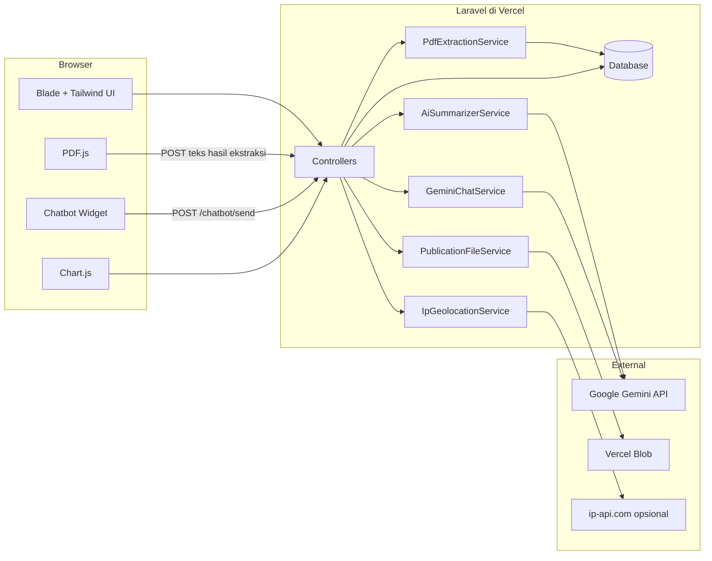
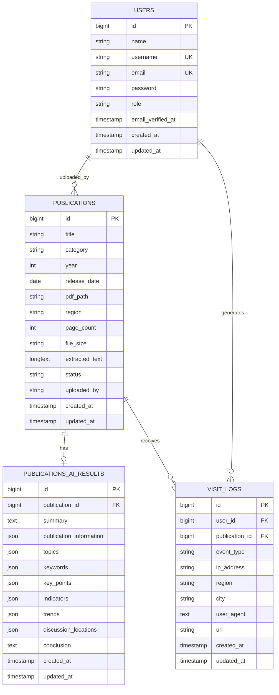

# PRODUCT REQUIREMENTS DOCUMENT (PRD)

## RINGKAS — Sistem Ringkasan & Manajemen Publikasi Statistik BPS

| Atribut | Detail |
| :--- | :--- |
| **Nama Produk** | RINGKAS |
| **Nama Lengkap** | Sistem Ringkasan & Manajemen Publikasi Statistik BPS |
| **Pemilik Produk** | Badan Pusat Statistik (BPS) Kota Tasikmalaya |
| **Status Dokumen** | Final — diselaraskan dengan implementasi |
| **Versi** | 2.0 |
| **Tanggal** | 29 Oktober 2026 |
| **Platform** | Aplikasi web responsif (desktop & mobile) |
| **Bahasa** | Bahasa Indonesia |
| **Pengguna** | Administrator BPS, user umum terdaftar, pengunjung publik |
| **Tech Stack** | Laravel 13, PHP 8.3, Blade, Tailwind CSS 4, Vite 8, SQLite/PostgreSQL, Vercel, Google Gemini API |

---

## 1. Ringkasan Eksekutif

RINGKAS adalah portal web yang membantu masyarakat, peneliti, akademisi, dan pengambil kebijakan memahami publikasi statistik BPS tanpa harus membaca seluruh dokumen PDF yang tebal. Dokumen publikasi diunggah oleh administrator, diekstrak teksnya, lalu dianalisis oleh AI untuk menghasilkan sembilan bagian ringkasan terstruktur: ringkasan publikasi, informasi publikasi, topik pembahasan, kata kunci, poin-poin penting, indikator statistik, tren, lokasi pembahasan, dan kesimpulan.

Produk terdiri dari dua pengalaman utama. **Portal publik** menampilkan landing page, katalog publikasi yang sudah selesai diringkas, pencarian dan filter, halaman detail sembilan bagian, unduhan PDF sumber, serta asisten AI yang dapat menjawab pertanyaan tentang katalog maupun dokumen tertentu. **Portal administrator** menyediakan dashboard statistik, pengelolaan publikasi, pemrosesan ulang AI, log aktivitas, manajemen pengguna, pengaturan akun, dan pemantauan kunjungan pembaca.

Dokumen ini menjadi acuan tunggal untuk kebutuhan produk, ruang lingkup rilis, kriteria penerimaan, model data, persyaratan non-fungsional, risiko, dan rencana pengembangan RINGKAS versi 2.0.

---

## 2. Latar Belakang & Masalah

### 2.1 Konteks

BPS menerbitkan publikasi statistik secara berkala dalam format PDF. Dokumen tersebut umumnya berisi puluhan hingga ratusan halaman, memuat metodologi, tabel, definisi indikator, dan analisis sektoral. Pembaca awam sering kesulitan menemukan intisari, sedangkan pembaca profesional membutuhkan waktu untuk memetakan bagian penting dari setiap dokumen.

### 2.2 Pernyataan Masalah

| ID | Masalah | Dampak |
| :--- | :--- | :--- |
| **P1** | Publikasi PDF panjang dan padat, sehingga sulit dipindai secara cepat. | Waktu pencarian informasi meningkat; publikasi jarang dimanfaatkan optimal. |
| **P2** | Metadata publikasi tersebar dan tidak seragam. | Pengguna sulit memfilter berdasarkan kategori, tahun, atau wilayah. |
| **P3** | Angka dan indikator penting terkubur di dalam narasi dan tabel. | Risiko salah kutip dan misinterpretasi data. |
| **P4** | Administrator membutuhkan proses unggah, pemrosesan, dan pemantauan yang konsisten. | Beban operasional meningkat seiring bertambahnya koleksi publikasi. |
| **P5** | Pengguna ingin bertanya langsung tentang isi dokumen. | Pencarian kata kunci biasa tidak cukup menjawab pertanyaan kontekstual. |

### 2.3 Tujuan Produk

1. **Mempercepat pemahaman publikasi** melalui ringkasan sembilan bagian yang konsisten dan mudah dipindai.
2. **Menyediakan katalog terpusat** yang dapat dicari berdasarkan judul, kategori, tahun, dan wilayah.
3. **Menyediakan asisten AI** yang menjawab pertanyaan berdasarkan katalog dan isi dokumen, dengan rujukan ke publikasi sumber.
4. **Menyederhanakan operasional admin** melalui unggah PDF, ekstraksi hybrid, regenerasi AI, dan log aktivitas.
5. **Memberikan visibilitas terhadap pemanfaatan koleksi** melalui statistik kunjungan dan unduhan.
6. **Menjaga akurasi dan keterlacakan** dengan selalu menyediakan akses ke PDF asli serta disclaimer bahwa AI dapat keliru.

### 2.4 Non-Goals (Tidak Termasuk dalam Rilis Ini)

- Pengganti resmi publikasi BPS atau sumber data tunggal.
- Chatbot yang menjawab topik di luar katalog publikasi.
- OCR penuh untuk PDF hasil pindaian.
- Ekstraksi tabel kompleks menjadi Excel/CSV.
- Multi-tenant untuk seluruh satuan kerja BPS di Indonesia.
- Aplikasi mobile native.
- Pembayaran, langganan, atau monetisasi.
- Single sign-on (SSO) dan verifikasi email.

---

## 3. Metrik Keberhasilan

| Metrik | Definisi | Target | Sumber |
| :--- | :--- | :--- | :--- |
| **Tingkat penyelesaian pemrosesan** | Persentase publikasi yang berhasil berstatus `Selesai` setelah ekstraksi | ≥ 90% untuk PDF dengan teks yang dapat dipilih | Tabel `publications` |
| **Waktu proses ringkasan** | Waktu dari klik ekstraksi hingga status `Selesai` | ≤ 90 detik untuk mayoritas dokumen; batas keras 180 detik | Log aplikasi |
| **Kelengkapan sembilan bagian** | Persentase halaman detail yang menampilkan seluruh bagian atau empty state yang jelas | 100% | QA |
| **Keberhasilan pencarian** | Persentase sesi pencarian yang membuka minimal satu hasil | ≥ 60% | Analytics aplikasi |
| **Penggunaan asisten AI** | Persentase pembaca yang mengirim minimal satu pertanyaan | ≥ 25% | `visit_logs`/log chatbot |
| **Waktu respons chatbot** | Waktu dari kirim pesan hingga balasan tampil | ≤ 8 detik (p95) | Log aplikasi |
| **Ketersediaan fallback** | Persentase kegagalan Gemini yang tetap mendapat jawaban lokal | 100% | Log aplikasi |
| **Insiden keamanan kritis** | Akses tidak sah ke area admin atau data pengguna | 0 | Audit keamanan |

---

## 4. Pengguna & Peran

### 4.1 Persona

| Persona | Deskripsi | Kebutuhan Utama |
| :--- | :--- | :--- |
| **Administrator BPS** | Staf yang mengelola publikasi dan memantau pemanfaatan portal. | Unggah cepat, status pemrosesan jelas, regenerasi AI, statistik pembaca, manajemen akun. |
| **User Umum** | Masyarakat, mahasiswa, peneliti, jurnalis, atau ASN yang telah mendaftar. | Mencari publikasi, membaca ringkasan, mengunduh PDF, bertanya kepada asisten AI. |
| **Pengunjung Publik** | Belum memiliki akun. | Memahami nilai produk, melihat kategori, lalu mendaftar atau masuk. |

### 4.2 Matriks Hak Akses

| Kapabilitas | Pengunjung | User | Admin |
| :--- | :---: | :---: | :---: |
| Melihat landing page | ✅ | ✅ | ✅ |
| Mendaftar akun | ✅ | — | — |
| Masuk portal user | — | ✅ | — |
| Masuk portal admin | — | — | ✅ |
| Melihat katalog & detail publikasi | — | ✅ | ✅ |
| Mengunduh PDF | — | ✅ | ✅ |
| Menggunakan chatbot | — | ✅ | ✅ |
| Mengelola publikasi | — | — | ✅ |
| Melihat dashboard & statistik pembaca | — | — | ✅ |
| Mengelola pengguna | — | — | ✅ |
| Melihat/menghapus log aktivitas | — | — | ✅ |

> Catatan: admin dan user menggunakan portal login yang terpisah. Akun admin tidak dapat masuk melalui `/login`, dan akun user tidak dapat masuk melalui `/admin/login`.

---

## 5. Ruang Lingkup Rilis 2.0

### 5.1 In Scope

- Landing page publik dengan penjelasan produk, alur kerja, fitur, kategori, dan CTA pendaftaran.
- Registrasi, login, logout, dan pembatasan akses berbasis peran.
- Katalog publikasi dengan pencarian dan filter kategori.
- Halaman detail publikasi dengan sembilan bagian analisis.
- Unduhan dokumen PDF sumber.
- Asisten AI dua mode: katalog universal dan dokumen spesifik.
- Dashboard admin dengan statistik publikasi, ringkasan, kunjungan, unduhan, wilayah, dan publikasi terpopuler.
- CRUD publikasi, unggah PDF, penggantian dokumen, dan regenerasi analisis AI.
- Pipeline ekstraksi hybrid: server-side parser dan fallback PDF.js di browser.
- Integrasi Gemini API dengan fallback heuristik lokal.
- Log aktivitas/notifikasi dengan filter, pencarian, tandai dibaca, dan hapus riwayat.
- Manajemen pengguna oleh admin dan pengaturan akun admin/user.
- Pencatatan kunjungan halaman dan unduhan untuk analitik.
- Dukungan penyimpanan lokal dan Vercel Blob.

### 5.2 Out of Scope

- OCR untuk PDF pindaian tanpa lapisan teks.
- Ringkasan audio/video atau format selain PDF.
- Kolaborasi real-time antar-admin.
- Komentar publik, rating, atau bookmark.
- Notifikasi email/WhatsApp.
- Reset password mandiri dan verifikasi email.
- Audit trail rinci per field (hanya log aktivitas ringkas).
- Ekspor laporan analitik ke Excel/PDF.

---

## 6. Arsitektur Sistem

### 6.1 Stack Teknologi

| Lapisan | Teknologi | Keterangan |
| :--- | :--- | :--- |
| Backend | Laravel 13.8, PHP 8.3 | Routing, autentikasi, validasi, ORM, session |
| Frontend | Blade, Tailwind CSS 4, Vite 8, JavaScript vanilla | Server-rendered views, komponen interaktif ringan |
| Ikon & grafik | Lucide Icons, Chart.js | Ikon antarmuka dan grafik dashboard |
| Parsing PDF (server) | `smalot/pdfparser` 2.12 | Ekstraksi teks dan jumlah halaman |
| Parsing PDF (client) | PDF.js 2.16 | Fallback ekstraksi teks di browser |
| AI | Google Gemini API | Ringkasan sembilan bagian dan chatbot |
| Database | SQLite (lokal), PostgreSQL/Neon (produksi) | Mendukung `DATABASE_URL` |
| Penyimpanan | Disk publik lokal, Vercel Blob | Abstraksi melalui `PublicationFileService` |
| Deployment | Vercel (PHP runtime + Node function) | Fungsi `api/index.php` dan `api/blob-upload.js` |
| Keamanan konten | DOMPurify | Sanitasi output Markdown chatbot |

### 6.2 Diagram Arsitektur



### 6.3 Alur Unggah Publikasi

```mermaid
flowchart TD
    A[Admin membuka form unggah] --> B{Apakah Vercel Blob aktif?}
    B -- Ya --> C[Ambil upload token HMAC 3 menit]
    C --> D[Upload PDF langsung ke Vercel Blob]
    D --> E[Kirim metadata + pdf_blob_url]
    B -- Tidak --> F[Upload multipart ke server]
    F --> G[Simpan ke storage/app/public/publications]
    E --> H[Validasi metadata & ukuran maks. 25 MB]
    G --> H
    H --> I[Simpan publikasi status Pending]
    I --> J[Catat notifikasi "Dokumen Diunggah"]
    J --> K[Redirect ke daftar publikasi]
```

### 6.4 Alur Ekstraksi & Analisis

```mermaid
flowchart TD
    A[Admin klik Ekstraksi] --> B{Apakah extracted_text sudah ada?}
    B -- Belum --> C[Materialisasi berkas lokal / unduh dari Blob]
    C --> D[PdfExtractionService]
    D --> E{Berhasil?}
    E -- Ya --> F[Teks + pages + page_count + file_size]
    E -- Gagal --> G[Fallback regex parser]
    G --> F
    B -- Sudah --> F
    F --> H[AiSummarizerService]
    H --> I{API key Gemini tersedia & teks ada?}
    I -- Ya --> J[Gemini generateContent]
    J --> K{Respons JSON valid?}
    K -- Ya --> L[Normalisasi hasil]
    K -- Tidak --> M[Perbaikan JSON]
    M --> N{Berhasil?}
    N -- Ya --> L
    N -- Tidak --> O[Heuristic fallback lokal]
    I -- Tidak --> O
    L --> P[Simpan publications_ai_results]
    O --> P
    P --> Q[Update publikasi: region, page_count, file_size, status Selesai]
    Q --> R[Catat notifikasi "Ekstraksi Sukses"]
    R --> S[Redirect ke detail publikasi]
```

### 6.5 Alur Fallback PDF.js

```mermaid
flowchart TD
    A[Admin membuka detail publikasi] --> B{extracted_text < 10 karakter?}
    B -- Tidak --> Z[Selesai]
    B -- Ya --> C[Tampilkan banner ekstraksi browser]
    C --> D[PDF.js memuat PDF]
    D --> E[Ekstrak teks maksimal 8 halaman pertama]
    E --> F[POST /admin/publications/{id}/save-extracted-text]
    F --> G[AI Summarizer]
    G --> H[Simpan hasil & status Selesai]
    H --> I[Render ulang halaman detail]
```

### 6.6 Tanggung Jawab Komponen Utama

| Komponen | Tanggung Jawab |
| :--- | :--- |
| `LandingController` | Landing page, hitung publikasi per kategori, redirect pengguna yang sudah login. |
| `UserAuthController` | Registrasi, login/logout user, beranda, profil, detail publikasi, unduhan. |
| `LoginController` | Login/logout admin, dashboard, pengaturan akun admin. |
| `PublicationController` | CRUD publikasi, ekstraksi, simpan teks klien, ringkasan, aktivitas. |
| `UserController` | CRUD pengguna oleh admin. |
| `ChatbotController` | Validasi pesan, delegasi ke layanan chatbot, saran pertanyaan. |
| `PdfExtractionService` | Parsing PDF server-side dan fallback regex stream. |
| `AiSummarizerService` | Prompt Gemini, parsing JSON, fallback heuristik, pemetaan halaman. |
| `GeminiChatService` | Konteks katalog/dokumen, riwayat percakapan, fallback lokal. |
| `PublicationFileService` | Resolusi URL, materialisasi file Blob, validasi URL tepercaya. |
| `TrackVisit` | Pencatatan view dengan deduplikasi per sesi. |
| `IpGeolocationService` | Lookup wilayah dari IP (opt-in) dengan cache 30 hari. |
| `RoleMiddleware` | Pembatasan akses berdasarkan peran `admin`/`user`. |

---

## 7. Information Architecture & Peta Rute

### 7.1 Peta Halaman

```text
Publik
├── /                          Landing page
├── /login                     Login user
├── /register                  Registrasi user
└── /admin/login               Login admin

User (role: user/admin)
├── /home                      Beranda & katalog publikasi
├── /profile                   Profil pengguna
├── /publications/{id}         Detail publikasi + chatbot
├── /publications/{id}/download Unduh PDF
├── POST /chatbot/send         Kirim pesan chatbot
└── GET /chatbot/suggestions   Saran pertanyaan

Admin (role: admin)
├── /admin/dashboard           Dashboard & statistik
├── /admin/publications        Daftar publikasi
├── /admin/publications/create Unggah publikasi
├── /admin/publications/{id}   Detail publikasi admin
├── /admin/publications/{id}/edit Edit publikasi
├── /admin/summaries           Daftar ringkasan selesai
├── /admin/activities          Log aktivitas
├── /admin/account-settings    Pengaturan akun admin
└── /admin/users               Manajemen pengguna
```

### 7.2 Inventaris Rute

| Method | Path | Nama Rute | Middleware | Fungsi |
| :--- | :--- | :--- | :--- | :--- |
| GET | `/` | `landing` | `track.visit` | Landing page |
| GET | `/admin/login` | `admin.login` | — | Form login admin |
| POST | `/admin/login` | `admin.login.post` | — | Proses login admin |
| POST | `/admin/logout` | `admin.logout` | — | Logout admin |
| GET | `/login` | `login` | — | Form login user |
| POST | `/login` | `login.post` | — | Proses login user |
| GET | `/register` | `register` | — | Form registrasi |
| POST | `/register` | `register.post` | — | Proses registrasi |
| POST | `/logout` | `logout` | — | Logout user |
| POST | `/notifications/read-all` | `notifications.read-all` | — | Tandai semua notifikasi dibaca |
| GET | `/home` | `home` | `role:user,admin`, `track.visit` | Beranda katalog |
| GET | `/profile` | `profile` | `role:user,admin` | Profil user |
| POST | `/profile` | `profile.update` | `role:user,admin` | Update profil user |
| GET | `/publications/{publication}` | `user.publications.show` | `role:user,admin`, `track.visit` | Detail publikasi |
| GET | `/publications/{publication}/download` | `user.publications.download` | `role:user,admin` | Unduh PDF |
| POST | `/chatbot/send` | `chatbot.send` | `role:user,admin`, `throttle:chatbot` | Kirim pesan AI |
| GET | `/chatbot/suggestions` | `chatbot.suggestions` | `role:user,admin` | Saran pertanyaan |
| GET | `/admin/dashboard` | `admin.dashboard` | `role:admin` | Dashboard |
| GET | `/admin/publications` | `publications.index` | `role:admin` | Daftar publikasi |
| GET | `/admin/publications/create` | `publications.create` | `role:admin` | Form unggah |
| POST | `/admin/publications/upload-token` | `publications.upload-token` | `role:admin`, `throttle:10,1` | Token upload Blob |
| POST | `/admin/publications` | `publications.store` | `role:admin` | Simpan publikasi |
| GET | `/admin/publications/{publication}` | `publications.show` | `role:admin` | Detail admin |
| GET | `/admin/publications/{publication}/edit` | `publications.edit` | `role:admin` | Form edit |
| PUT | `/admin/publications/{publication}` | `publications.update` | `role:admin` | Update publikasi |
| POST | `/admin/publications/{publication}/extract` | `publications.extract` | `role:admin` | Ekstraksi/regenerasi AI |
| POST | `/admin/publications/{publication}/save-extracted-text` | `publications.saveExtractedText` | `role:admin` | Simpan teks dari PDF.js |
| DELETE | `/admin/publications/{publication}` | `publications.destroy` | `role:admin` | Hapus publikasi |
| GET | `/admin/summaries` | `admin.summaries` | `role:admin` | Daftar ringkasan |
| GET | `/admin/activities` | `activities.index` | `role:admin` | Log aktivitas |
| DELETE | `/admin/activities/clear` | `activities.clear` | `role:admin` | Hapus semua log |
| GET | `/admin/account-settings` | `account.settings` | `role:admin` | Pengaturan akun |
| POST | `/admin/account-settings` | `account.settings.update` | `role:admin` | Update profil admin |
| POST | `/admin/account-settings/password` | `account.settings.password` | `role:admin` | Ubah password admin |
| GET/POST/PUT/DELETE | `/admin/users/*` | `users.*` | `role:admin` | CRUD pengguna |

---

## 8. Persyaratan Fungsional

Prioritas menggunakan skala **Must** (wajib rilis), **Should** (penting, dapat menyusul), dan **Could** (nice to have).

### 8.1 Landing Page Publik

**Tujuan:** memperkenalkan RINGKAS, menjelaskan alur kerja, dan mengarahkan pengunjung untuk mendaftar atau masuk.

| ID | Kebutuhan | Prioritas |
| :--- | :--- | :--- |
| FR-LND-01 | Menampilkan hero, penjelasan produk, alur 4 langkah, fitur utama, contoh hasil, kategori publikasi, dan CTA pendaftaran. | Must |
| FR-LND-02 | Menampilkan jumlah publikasi terringkas per kategori resmi BPS. | Must |
| FR-LND-03 | Pengguna yang sudah login otomatis diarahkan ke `/home`. | Must |
| FR-LND-04 | Menyediakan tautan ke portal resmi BPS dan informasi kontak BPS Kota Tasikmalaya. | Should |
| FR-LND-05 | Mencatat kunjungan landing page (satu kali per sesi). | Should |
| FR-LND-06 | Menampilkan disclaimer bahwa hasil AI dapat keliru dan dokumen asli tetap menjadi rujukan. | Must |

**Kriteria Penerimaan**
- Pengunjung tanpa akun dapat membuka `/` dan melihat konten lengkap.
- Jumlah kategori dihitung hanya dari publikasi berstatus `Selesai`.
- Klik CTA "Buat akun" mengarah ke `/register`; klik "Masuk" mengarah ke `/login`.
- Tidak ada error saat belum ada publikasi (empty state tampil).

---

### 8.2 Autentikasi, Registrasi, dan Otorisasi

**Tujuan:** memisahkan akses admin dan user serta melindungi data.

| ID | Kebutuhan | Prioritas |
| :--- | :--- | :--- |
| FR-AUTH-01 | Registrasi user dengan username, email, password, dan konfirmasi password. | Must |
| FR-AUTH-02 | Username dan email unik; password minimal 8 karakter. | Must |
| FR-AUTH-03 | Setelah registrasi berhasil, user otomatis login dan diarahkan ke `/home`. | Must |
| FR-AUTH-04 | Login user hanya menerima akun dengan role `user`; akun admin ditolak dengan pesan jelas. | Must |
| FR-AUTH-05 | Login admin hanya menerima akun dengan role `admin`; akun user ditolak. | Must |
| FR-AUTH-06 | Seluruh rute admin dilindungi middleware `role:admin`. | Must |
| FR-AUTH-07 | Rute user dilindungi middleware `role:user,admin`. | Must |
| FR-AUTH-08 | Session diregenerasi setelah login; logout menginvalidasi session dan token CSRF. | Must |
| FR-AUTH-09 | Registrasi baru membuat notifikasi "User Baru Mendaftar" untuk admin. | Should |
| FR-AUTH-10 | Percobaan akses tanpa login diarahkan ke portal login yang sesuai. | Must |

**Kriteria Penerimaan**
- User yang mencoba membuka `/admin/dashboard` diarahkan kembali dengan pesan akses ditolak.
- Admin yang logout tidak dapat menggunakan tombol back untuk membuka dashboard.
- Validasi menampilkan pesan berbahasa Indonesia di dekat field terkait.
- Password disimpan sebagai hash, tidak pernah ditampilkan kembali.

---

### 8.3 Katalog Publikasi User

**Tujuan:** memudahkan penemuan publikasi yang sudah selesai diringkas.

| ID | Kebutuhan | Prioritas |
| :--- | :--- | :--- |
| FR-CAT-01 | Beranda menampilkan hanya publikasi berstatus `Selesai`. | Must |
| FR-CAT-02 | Pencarian berdasarkan judul, kategori, tahun, dan wilayah. | Must |
| FR-CAT-03 | Filter kategori untuk 8 kategori resmi BPS. | Must |
| FR-CAT-04 | Menampilkan jumlah publikasi per kategori dan total publikasi tersedia. | Should |
| FR-CAT-05 | Menampilkan empty state ketika pencarian tidak menemukan hasil. | Must |
| FR-CAT-06 | Urutan default adalah publikasi terbaru. | Must |

**Kriteria Penerimaan**
- Publikasi berstatus `Pending` tidak pernah muncul di katalog user, termasuk melalui URL langsung.
- Pencarian `2024` menemukan publikasi tahun 2024.
- Pencarian `Tasikmalaya` menemukan publikasi dengan wilayah tersebut.
- Filter kategori dapat dikombinasikan dengan pencarian.

---

### 8.4 Detail Publikasi User

**Tujuan:** menyajikan analisis terstruktur dan akses ke dokumen sumber.

| ID | Kebutuhan | Prioritas |
| :--- | :--- | :--- |
| FR-DET-01 | Menampilkan **9 bagian**: Ringkasan Publikasi, Informasi Publikasi, Topik Pembahasan, Kata Kunci, Poin-Poin Penting, Indikator Utama, Tren Utama, Lokasi Pembahasan, Kesimpulan. | Must |
| FR-DET-02 | Menampilkan metadata: judul, kategori, tahun, wilayah, jumlah halaman, ukuran berkas, tanggal unggah. | Must |
| FR-DET-03 | Menyediakan tombol unduh PDF dan tautan buka PDF. | Must |
| FR-DET-04 | Bagian yang tidak memiliki data menampilkan empty state yang informatif, bukan halaman rusak. | Must |
| FR-DET-05 | Menampilkan indikator dalam tabel nama–nilai–satuan dan tren dengan label Meningkat/Menurun/Stabil. | Must |
| FR-DET-06 | Menampilkan disclaimer AI dan tautan ke publikasi asli. | Must |
| FR-DET-07 | Menyediakan widget chatbot dalam mode dokumen. | Should |

**Kriteria Penerimaan**
- Membuka publikasi `Pending` melalui URL langsung diarahkan ke `/home` dengan pesan bahwa publikasi belum tersedia.
- Semua 9 bagian dirender dalam satu halaman responsif.
- Jika `indicators` kosong, tabel tidak error dan menampilkan pesan "Data indikator tidak tersedia".
- Tombol unduh menghasilkan nama berkas yang aman dan berbasis slug judul.

---

### 8.5 Asisten AI (Chatbot)

**Tujuan:** menjawab pertanyaan pengguna berdasarkan katalog dan isi publikasi.

| ID | Kebutuhan | Prioritas |
| :--- | :--- | :--- |
| FR-CHAT-01 | Menyediakan widget chatbot di beranda, profil, dan detail publikasi. | Must |
| FR-CHAT-02 | **Mode universal**: konteks seluruh katalog publikasi `Selesai`. | Must |
| FR-CHAT-03 | **Mode dokumen**: konteks publikasi yang sedang dibuka, termasuk ringkasan, indikator, poin penting, tren, kesimpulan, dan kutipan teks. | Must |
| FR-CHAT-04 | Menyediakan saran pertanyaan awal yang berbeda untuk mode universal dan dokumen. | Should |
| FR-CHAT-05 | Menyimpan riwayat percakapan di sisi klien dan mengirim maksimal 20 entri; server hanya memakai 8 entri terakhir. | Must |
| FR-CHAT-06 | Membatasi panjang pesan maksimal 3.000 karakter. | Must |
| FR-CHAT-07 | Membatasi laju 15 permintaan per menit per user/IP. | Must |
| FR-CHAT-08 | Jika Gemini tidak tersedia, memberikan jawaban fallback dari data lokal. | Must |
| FR-CHAT-09 | Menyediakan jawaban untuk sapaan, bantuan, permintaan rangkuman, definisi istilah (IPM, Gini, inflasi, PDRB, TPT), dan pencarian katalog. | Should |
| FR-CHAT-10 | Merender Markdown dengan aman menggunakan DOMPurify. | Must |
| FR-CHAT-11 | Menyediakan tombol bersihkan percakapan dan tutup widget. | Should |
| FR-CHAT-12 | Menampilkan badge mode (universal/dokumen) dan judul dokumen aktif. | Should |

**Kriteria Penerimaan**
- Pertanyaan "Apa kesimpulan dokumen ini?" pada halaman detail dijawab dengan konteks dokumen tersebut.
- Pertanyaan "Cari publikasi tentang kemiskinan" di beranda mengembalikan tautan publikasi relevan.
- Saat `GEMINI_API_KEY` kosong, chatbot tetap merespons dan memberi tahu bahwa jawaban berasal dari data tersimpan.
- Permintaan ke-16 dalam satu menit menerima respons 429 dengan pesan yang ramah.
- HTML/script berbahaya pada balasan AI tidak dieksekusi.

---

### 8.6 Dashboard & Analitik Admin

**Tujuan:** memberikan gambaran koleksi dan pemanfaatan portal.

| ID | Kebutuhan | Prioritas |
| :--- | :--- | :--- |
| FR-DASH-01 | Menampilkan total publikasi, total ringkasan `Selesai`, dan total kategori. | Must |
| FR-DASH-02 | Menampilkan grafik publikasi per kategori (doughnut). | Must |
| FR-DASH-03 | Menampilkan grafik ringkasan per bulan untuk 6 bulan terakhir. | Must |
| FR-DASH-04 | Menampilkan total kunjungan halaman, total unduhan, dan pengunjung unik. | Must |
| FR-DASH-05 | Menampilkan grafik kunjungan 7 hari terakhir. | Must |
| FR-DASH-06 | Menampilkan top 8 wilayah kunjungan. | Should |
| FR-DASH-07 | Menampilkan top 5 publikasi terpopuler. | Should |
| FR-DASH-08 | Menampilkan 10 kunjungan terbaru dengan IP tersamarkan. | Should |
| FR-DASH-09 | Menampilkan 5 publikasi terbaru. | Must |
| FR-DASH-10 | Menyediakan tampilan statistik terpisah melalui parameter `?view=statistics`. | Could |
| FR-DASH-11 | Dashboard tetap dapat dibuka meskipun tabel `visit_logs` belum dimigrasikan. | Must |

**Kriteria Penerimaan**
- Angka kartu sesuai dengan isi database.
- Grafik kosong menampilkan empty state, bukan canvas kosong.
- IP pada tabel kunjungan terbaru disamarkan (contoh `192.168.1.xxx`).
- Data wilayah "Tidak diketahui" tetap dihitung dan ditampilkan.

---

### 8.7 Pengelolaan Publikasi (Admin)

**Tujuan:** mengelola siklus hidup publikasi dari unggah hingga siap dibaca publik.

| ID | Kebutuhan | Prioritas |
| :--- | :--- | :--- |
| FR-PUB-01 | Menampilkan daftar publikasi dengan filter status, kategori, pencarian judul/kategori, dan urutan terbaru. | Must |
| FR-PUB-02 | Menampilkan ringkasan status: total publikasi, selesai, pending, kategori. | Should |
| FR-PUB-03 | Form unggah menerima PDF maksimal 25 MB, judul, kategori, dan tanggal rilis. | Must |
| FR-PUB-04 | Tahun publikasi dihitung otomatis dari tanggal rilis. | Must |
| FR-PUB-05 | Ukuran berkas diformat otomatis (B/KB/MB) dan jumlah halaman dihitung atau diisi dari klien. | Must |
| FR-PUB-06 | Publikasi baru disimpan dengan status `Pending` dan belum dapat diakses publik. | Must |
| FR-PUB-07 | Admin dapat mengganti PDF; dokumen lama dihapus dan hasil AI lama dihapus. | Must |
| FR-PUB-08 | Mengganti PDF mengembalikan status ke `Pending` dan mengosongkan teks/hasil analisis. | Must |
| FR-PUB-09 | Mengubah metadata tanpa mengganti PDF tetap mempertahankan hasil AI dan memperbarui `publication_information`. | Must |
| FR-PUB-10 | Admin dapat menghapus publikasi beserta berkas lokalnya. | Must |
| FR-PUB-11 | Setiap aksi unggah, ubah, hapus, dan ekstraksi mencatat notifikasi. | Must |
| FR-PUB-12 | Halaman detail admin menampilkan analisis lengkap, tombol lihat/unduh PDF, dan tombol "Generate Ulang AI". | Must |
| FR-PUB-13 | Daftar ringkasan (`/admin/summaries`) hanya menampilkan publikasi `Selesai`. | Must |

**Kriteria Penerimaan**
- Mengunggah file non-PDF ditolak dengan pesan validasi.
- File > 25 MB ditolak pada validasi server dan/atau Blob.
- Setelah unggah, pengguna diarahkan ke daftar dengan notifikasi sukses.
- Setelah mengganti PDF, status berubah menjadi `Pending` dan hasil AI lama tidak lagi tampil.
- Menghapus publikasi menghapus baris `publications_ai_results` terkait (cascade).

---

### 8.8 Pipeline Ekstraksi PDF

**Tujuan:** mendapatkan teks dan metadata dari PDF secara andal, termasuk untuk file besar atau terkunci.

| ID | Kebutuhan | Prioritas |
| :--- | :--- | :--- |
| FR-EXT-01 | Ekstraksi server-side menggunakan `smalot/pdfparser`. | Must |
| FR-EXT-02 | Jika parser gagal, gunakan parser regex stream PDF sebagai fallback. | Must |
| FR-EXT-03 | Hitung jumlah halaman cepat dari struktur PDF tanpa memuat seluruh teks. | Should |
| FR-EXT-04 | Untuk file > 5 MB, batasi parsing server maksimal 8 halaman pertama. | Must |
| FR-EXT-05 | Untuk file ≤ 5 MB, parsing dapat mencapai 500 halaman. | Should |
| FR-EXT-06 | Jika teks < 10 karakter, tampilkan banner dan jalankan PDF.js untuk 8 halaman pertama. | Must |
| FR-EXT-07 | Kirim hasil ekstraksi klien ke `save-extracted-text` dan lanjutkan ke AI. | Must |
| FR-EXT-08 | Bersihkan file temporer setelah pemrosesan. | Must |
| FR-EXT-09 | Tampilkan progres ekstraksi klien (0–100%) kepada admin. | Should |
| FR-EXT-10 | Sediakan tombol regenerasi AI untuk memproses ulang tanpa mengunggah ulang PDF. | Must |

**Kriteria Penerimaan**
- PDF normal 10 halaman menghasilkan teks dan jumlah halaman yang benar.
- PDF > 5 MB hanya memproses 8 halaman pertama di server dan tidak memicu timeout.
- PDF terkunci/scan memicu fallback PDF.js saat halaman detail dibuka.
- Setelah fallback selesai, status berubah menjadi `Selesai` dan hasil analisis tampil.
- File temporer hasil unduhan Blob tidak tertinggal di disk.

---

### 8.9 Analisis AI Sembilan Bagian

**Tujuan:** menghasilkan analisis konsisten dan terstruktur dari teks publikasi.

| ID | Kebutuhan | Prioritas |
| :--- | :--- | :--- |
| FR-AI-01 | Mengirim maksimal 40.000 karakter pertama teks ke Gemini. | Must |
| FR-AI-02 | Meminta output JSON dengan skema tetap (lihat §10.1). | Must |
| FR-AI-03 | Menyimpan hasil ke `publications_ai_results` dengan relasi satu-ke-satu. | Must |
| FR-AI-04 | Menyimpan `region` hasil deteksi AI ke tabel publikasi. | Must |
| FR-AI-05 | Memetakan topik ke nomor halaman berdasarkan kemunculan teks. | Must |
| FR-AI-06 | Membersihkan markdown code fence, newline liar, dan kurung kurawal yang terpotong sebelum parsing JSON. | Must |
| FR-AI-07 | Jika Gemini gagal atau API key kosong, gunakan heuristic engine lokal. | Must |
| FR-AI-08 | Heuristic engine mendeteksi wilayah, topik, kata kunci, poin penting, indikator, tren, dan kesimpulan dari teks. | Must |
| FR-AI-09 | Jika teks kosong, hasilkan struktur valid dengan nilai "Data tidak tersedia pada publikasi ini." | Must |
| FR-AI-10 | Gunakan timeout 45 detik dan `maxOutputTokens` 4.096 untuk ringkasan. | Must |
| FR-AI-11 | Setelah berhasil, ubah status publikasi menjadi `Selesai`. | Must |
| FR-AI-12 | Catat notifikasi keberhasilan ekstraksi/AI. | Must |

**Kriteria Penerimaan**
- Hasil analisis selalu memiliki 9 kunci data yang dapat dirender.
- Respons Gemini dengan code fence tetap dapat diparse.
- Respons Gemini terpotong tetap diusahakan diperbaiki; jika gagal, fallback lokal berjalan.
- Publikasi berstatus `Selesai` hanya setelah hasil AI tersimpan.
- Tidak ada data publikasi lama yang tertimpa saat regenerasi gagal sebelum penyimpanan.

---

### 8.10 Log Aktivitas & Notifikasi

**Tujuan:** memberi jejak aktivitas penting bagi administrator.

| ID | Kebutuhan | Prioritas |
| :--- | :--- | :--- |
| FR-ACT-01 | Menampilkan log aktivitas terbaru dengan paginasi 15 item. | Must |
| FR-ACT-02 | Filter berdasarkan tipe aktivitas dan pencarian pada judul/pesan. | Should |
| FR-ACT-03 | Tipe aktivitas mencakup `upload`, `delete`, `summary`, `info`, `success`, `warning`, `danger`. | Should |
| FR-ACT-04 | Bell notifikasi menampilkan 5 notifikasi terbaru dan jumlah yang belum dibaca. | Must |
| FR-ACT-05 | Admin dapat menandai semua notifikasi sebagai dibaca. | Must |
| FR-ACT-06 | Admin dapat menghapus seluruh riwayat aktivitas. | Must |
| FR-ACT-07 | Aksi hapus seluruh riwayat meminta konfirmasi. | Should |

**Kriteria Penerimaan**
- Setiap unggah, ubah, hapus, registrasi, dan ekstraksi menghasilkan baris notifikasi.
- Jumlah badge berkurang menjadi 0 setelah "Tandai semua dibaca".
- Menghapus riwayat mengosongkan tabel dan menampilkan pesan sukses.
- Filter tipe `upload` hanya menampilkan aktivitas unggah.

---

### 8.11 Manajemen Pengguna (Admin)

**Tujuan:** mengelola akun admin dan user.

| ID | Kebutuhan | Prioritas |
| :--- | :--- | :--- |
| FR-USR-01 | Menampilkan daftar pengguna dengan pencarian nama/username/email dan paginasi 10. | Must |
| FR-USR-02 | Admin dapat membuat pengguna baru dengan nama, username, email, password, dan role. | Must |
| FR-USR-03 | Admin dapat mengubah data pengguna dan role. | Must |
| FR-USR-04 | Admin dapat menghapus pengguna. | Must |
| FR-USR-05 | Admin tidak dapat menghapus akunnya sendiri. | Must |
| FR-USR-06 | Password baru opsional saat edit; jika diisi, minimal 6 karakter dan dikonfirmasi. | Must |
| FR-USR-07 | Setiap perubahan pengguna mencatat notifikasi. | Should |
| FR-USR-08 | Jika admin mengubah akunnya sendiri, data session ikut diperbarui. | Must |

**Kriteria Penerimaan**
- Username/email duplikat ditolak.
- Role hanya dapat bernilai `admin` atau `user`.
- Tombol hapus untuk akun sendiri tidak menghasilkan penghapusan.
- Pengguna baru dapat login sesuai portal rolenya.

---

### 8.12 Pengaturan Akun

**Tujuan:** memungkinkan pengguna memperbarui profil dan kredensial.

| ID | Kebutuhan | Prioritas |
| :--- | :--- | :--- |
| FR-ACC-01 | Admin dapat memperbarui nama, username, dan email. | Must |
| FR-ACC-02 | Admin dapat mengubah password dengan verifikasi password lama. | Must |
| FR-ACC-03 | User dapat memperbarui nama, username, email, dan password opsional. | Must |
| FR-ACC-04 | Password baru user minimal 8 karakter dan dikonfirmasi. | Must |
| FR-ACC-05 | Perubahan akun admin mencatat notifikasi. | Should |

**Kriteria Penerimaan**
- Password lama yang salah menampilkan error pada field terkait.
- Perubahan username/email langsung tercermin pada session dan login berikutnya.
- Password tidak pernah dikirim balik ke form dalam bentuk plaintext.

---

### 8.13 Pelacakan Kunjungan & Analitik

**Tujuan:** mengukur pemanfaatan portal tanpa mengganggu pengalaman pengguna.

| ID | Kebutuhan | Prioritas |
| :--- | :--- | :--- |
| FR-TRK-01 | Catat `view` pada landing, beranda, dan detail publikasi. | Must |
| FR-TRK-02 | Catat `download` saat pengguna mengunduh PDF. | Must |
| FR-TRK-03 | Deduplikasi view per sesi per halaman/publikasi. | Must |
| FR-TRK-04 | Simpan user ID (jika login), publikasi, IP, wilayah, kota, user agent, URL, dan waktu. | Must |
| FR-TRK-05 | Sediakan lookup wilayah dari IP secara opsional dengan cache 30 hari. | Could |
| FR-TRK-06 | Tampilkan IP tersamarkan di dashboard. | Must |
| FR-TRK-07 | Kegagalan pencatatan tidak boleh menggagalkan request utama. | Must |

**Kriteria Penerimaan**
- Membuka halaman detail yang sama dua kali dalam satu sesi hanya mencatat satu view.
- Unduhan selalu mencatat satu event `download`.
- IP privat tercatat sebagai wilayah "Lokal".
- Jika layanan geolokasi gagal/timeout, wilayah menjadi "Tidak diketahui" tanpa error.

---

### 8.14 Penyimpanan Berkas

**Tujuan:** menyimpan PDF secara aman dan portabel antara lokal dan produksi.

| ID | Kebutuhan | Prioritas |
| :--- | :--- | :--- |
| FR-FIL-01 | Simpan PDF lokal di `storage/app/public/publications` dengan nama UUID. | Must |
| FR-FIL-02 | Dukung Vercel Blob untuk unggahan langsung dari browser. | Must |
| FR-FIL-03 | Hanya terima URL Blob dengan skema HTTPS, host `*.public.blob.vercel-storage.com`, dan path `/publications/`. | Must |
| FR-FIL-04 | Token unggah berlaku 3 menit dan ditandatangani HMAC-SHA256 dengan `APP_KEY`. | Must |
| FR-FIL-05 | Batasi tipe konten PDF dan ukuran 25 MB pada fungsi unggah Blob. | Must |
| FR-FIL-06 | Sediakan URL publik yang konsisten melalui `PublicationFileService`. | Must |
| FR-FIL-07 | Unduhan lokal menggunakan nama file berbasis slug judul. | Should |

**Kriteria Penerimaan**
- URL Blob dari domain lain ditolak.
- Token kedaluwarsa atau tanda tangan tidak valid menghasilkan 403.
- Menghapus publikasi lokal menghapus file fisiknya.
- Mengganti PDF lokal menghapus file lama.

---

## 9. Model Data

### 9.1 Diagram Relasi



### 9.2 Tabel `users`

| Kolom | Tipe | Aturan | Keterangan |
| :--- | :--- | :--- | :--- |
| `id` | BIGINT | PK, auto increment | ID pengguna |
| `name` | VARCHAR(255) | NOT NULL | Nama lengkap |
| `username` | VARCHAR(255) | UNIQUE, NOT NULL | Kredensial login |
| `email` | VARCHAR(255) | UNIQUE, NOT NULL | Alamat email |
| `email_verified_at` | TIMESTAMP | NULL | Belum digunakan |
| `password` | VARCHAR(255) | NOT NULL | Hash password |
| `role` | VARCHAR(50) | DEFAULT `user` | `admin` atau `user` |
| `remember_token` | VARCHAR(100) | NULL | Remember me |
| `created_at`, `updated_at` | TIMESTAMP | NULL | Audit waktu |

### 9.3 Tabel `publications`

| Kolom | Tipe | Aturan | Keterangan |
| :--- | :--- | :--- | :--- |
| `id` | BIGINT | PK | ID publikasi |
| `title` | VARCHAR(255) | NOT NULL | Judul publikasi |
| `category` | VARCHAR(255) | NOT NULL | Salah satu dari 8 kategori resmi |
| `year` | INT | NOT NULL | Diturunkan dari `release_date` |
| `release_date` | DATE | NOT NULL | Tanggal rilis |
| `pdf_path` | VARCHAR(255) | NOT NULL | Path lokal atau URL Blob |
| `region` | VARCHAR(255) | NULL | Wilayah hasil deteksi AI |
| `page_count` | INT | NULL | Jumlah halaman |
| `file_size` | VARCHAR(50) | NULL | Ukuran terformat, mis. `2.45 MB` |
| `extracted_text` | LONGTEXT | NULL | Teks hasil ekstraksi |
| `status` | VARCHAR(50) | DEFAULT `Pending` | `Pending` atau `Selesai` |
| `uploaded_by` | VARCHAR(100) | DEFAULT `Admin BPS` | Label pengunggah |
| `summary`, `topics`, `keywords`, `key_points`, `indicators`, `trends`, `page_locations`, `conclusion` | campuran | NULL | **Legacy** — dipertahankan untuk kompatibilitas; sumber utama ada di `publications_ai_results` |
| `created_at`, `updated_at` | TIMESTAMP | NULL | Audit waktu |

**Indeks yang disarankan:** `category`, `year`, `status`, `region`, `release_date`, dan pencarian teks pada `title`.

### 9.4 Tabel `publications_ai_results`

| Kolom | Tipe | Aturan | Keterangan |
| :--- | :--- | :--- | :--- |
| `id` | BIGINT | PK | ID hasil |
| `publication_id` | BIGINT | FK UNIQUE, cascade delete | Relasi satu-ke-satu |
| `summary` | TEXT | NOT NULL | Ringkasan 3 paragraf |
| `publication_information` | JSON | NOT NULL | Metadata hasil analisis |
| `topics` | JSON | NOT NULL | Array topik |
| `keywords` | JSON | NOT NULL | Array kata kunci |
| `key_points` | JSON | NOT NULL | Array poin penting |
| `indicators` | JSON | NOT NULL | Array `{name, value, unit}` |
| `trends` | JSON | NOT NULL | Array `{indicator, trend, icon}` |
| `discussion_locations` | JSON | NOT NULL | Array `{topic, page}` |
| `conclusion` | TEXT | NOT NULL | Kesimpulan eksekutif |
| `created_at`, `updated_at` | TIMESTAMP | NULL | Audit waktu |

### 9.5 Tabel `notifications`

| Kolom | Tipe | Aturan | Keterangan |
| :--- | :--- | :--- | :--- |
| `id` | BIGINT | PK | ID notifikasi |
| `title` | VARCHAR(255) | NOT NULL | Judul singkat |
| `message` | TEXT | NOT NULL | Pesan lengkap |
| `type` | VARCHAR(50) | NOT NULL | Kategori aktivitas |
| `is_read` | BOOLEAN | DEFAULT false | Status baca |
| `created_at`, `updated_at` | TIMESTAMP | NULL | Waktu kejadian |

### 9.6 Tabel `visit_logs`

| Kolom | Tipe | Aturan | Keterangan |
| :--- | :--- | :--- | :--- |
| `id` | BIGINT | PK | ID kunjungan |
| `user_id` | BIGINT | FK NULL, null on delete | Pengguna (jika login) |
| `publication_id` | BIGINT | FK NULL, null on delete | Publikasi terkait |
| `event_type` | VARCHAR(20) | DEFAULT `view` | `view` atau `download` |
| `ip_address` | VARCHAR(45) | NULL | IPv4/IPv6 |
| `region` | VARCHAR(100) | NULL | Provinsi/wilayah |
| `city` | VARCHAR(100) | NULL | Kota/kabupaten |
| `user_agent` | TEXT | NULL | Maks. 500 karakter saat disimpan |
| `url` | VARCHAR(500) | NULL | Path halaman |
| `created_at`, `updated_at` | TIMESTAMP | NULL | Waktu kejadian |

**Indeks:** `(event_type, created_at)`, `region`, `publication_id`.

### 9.7 Status & Enum

| Entitas | Nilai | Arti |
| :--- | :--- | :--- |
| `users.role` | `admin` | Akses penuh ke portal admin |
| `users.role` | `user` | Akses portal pembaca |
| `publications.status` | `Pending` | Sudah diunggah, belum dianalisis |
| `publications.status` | `Selesai` | Analisis tersedia dan tampil publik |
| `visit_logs.event_type` | `view` | Kunjungan halaman |
| `visit_logs.event_type` | `download` | Unduhan PDF |
| `publications.category` | 8 kategori | Publikasi Umum, Statistik Sosial, Statistik Ekonomi, Statistik Pertanian, Statistik Industri, Statistik Distribusi, Statistik Lingkungan, Sensus & Survei |

> Catatan: migrasi lama menetapkan default `Menunggu Proses`, sedangkan aplikasi secara eksplisit menulis `Pending`. Kedua nilai tidak boleh dianggap setara oleh kode baru; standarkan pada `Pending`.

---

## 10. Kontrak Integrasi

### 10.1 Skema Output AI Summarizer

```json
{
  "summary": "string (3 paragraf dipisahkan \\n\\n)",
  "region": "string",
  "topics": ["string"],
  "keywords": ["string"],
  "key_points": ["string"],
  "indicators": [
    { "name": "string", "value": "string", "unit": "string" }
  ],
  "trends": [
    { "indicator": "string", "trend": "Meningkat|Menurun|Stabil", "icon": "📈|📉|➖" }
  ],
  "conclusion": "string"
}
```

**Aturan normalisasi server:**
- `discussion_locations` tidak diminta langsung dari AI; server memetakan `topics` ke halaman berdasarkan kemunculan teks.
- `publication_information` dibentuk server dari metadata publikasi + `region` hasil AI.
- Jika `summary` kosong, hasil tetap disimpan tetapi UI menampilkan empty state.
- `trends` dinormalisasi ke tiga nilai baku dan ikon yang sesuai.

### 10.2 Endpoint Chatbot

**Request** `POST /chatbot/send`

```json
{
  "message": "Apa kesimpulan utama dokumen ini?",
  "publication_id": 12,
  "history": [
    { "role": "user", "text": "Halo" },
    { "role": "model", "text": "Halo, ada yang bisa saya bantu?" }
  ]
}
```

**Response 200**

```json
{
  "status": "success",
  "reply": "Markdown string",
  "mode": "document",
  "publication": { "id": 12, "title": "..." }
}
```

**Aturan:**
- `message` wajib, string, maksimal 3.000 karakter.
- `publication_id` opsional dan harus ada di database.
- `history` maksimal 20 entri; server memakai 8 entri terakhir.
- Rate limit: 15 permintaan/menit per user/IP.
- Timeout Gemini: 35 detik; `temperature` 0,4; `maxOutputTokens` 2.048.

### 10.3 Endpoint Saran Pertanyaan

**Request** `GET /chatbot/suggestions?publication_id=12`

**Response mode dokumen**

```json
{
  "mode": "document",
  "title": "Judul Publikasi",
  "category": "Statistik Sosial",
  "year": 2025,
  "suggestions": ["Apa kesimpulan utama dokumen ini?"]
}
```

**Response mode universal**

```json
{
  "mode": "universal",
  "title": "Katalog Publikasi BPS",
  "suggestions": ["Ada di publikasi mana data IPM terbaru?"]
}
```

### 10.4 Unggah Blob

1. `POST /admin/publications/upload-token` mengembalikan token HMAC berlaku 3 menit.
2. Browser mengunggah PDF ke `POST /api/blob-upload` dengan `clientPayload` berisi token.
3. Fungsi memvalidasi tanda tangan, role admin, masa berlaku, tipe konten PDF, dan ukuran maksimal 25 MB.
4. Server menerima `pdf_blob_url` dan memvalidasi domain serta path.
5. Server menyimpan URL dan metadata publikasi.

**Kegagalan yang harus ditangani:** 403 token tidak valid/kedaluwarsa, 405 metode salah, 503 Blob belum dikonfigurasi, 400 unggahan gagal.

---

## 11. Persyaratan Non-Fungsional

### 11.1 Performa

| Aspek | Target |
| :--- | :--- |
| Waktu muat landing & beranda | ≤ 2,5 detik (p95, jaringan 4G) |
| Waktu muat detail publikasi | ≤ 3 detik (p95) |
| Waktu proses ekstraksi + AI | ≤ 90 detik untuk mayoritas; batas 180 detik |
| Waktu respons chatbot | ≤ 8 detik (p95) |
| Ukuran PDF maksimal | 25 MB |
| Teks yang dikirim ke Gemini | Maksimal 40.000 karakter |
| Parsing server file > 5 MB | Maksimal 8 halaman |
| Timeout Gemini ringkasan | 45 detik |
| Timeout Gemini chatbot | 35 detik |

**Catatan:** semua pemrosesan AI berjalan sinkron di request. Untuk koleksi besar, ini menjadi bottleneck utama dan perlu dipindahkan ke queue pada rilis berikutnya.

### 11.2 Keamanan

- **Autentikasi:** session-based, password di-hash, regenerasi session setelah login.
- **Otorisasi:** middleware `role:admin` dan `role:user,admin` pada seluruh rute sensitif.
- **CSRF:** token pada semua form POST/PUT/DELETE.
- **Validasi unggahan:** MIME `application/pdf`, ekstensi `.pdf`, maksimal 25 MB, nama file UUID.
- **Blob:** HMAC-SHA256, masa berlaku 3 menit, validasi host dan path, tipe konten dibatasi.
- **XSS:** escape Blade secara default; output Markdown chatbot disanitasi DOMPurify.
- **Rate limiting:** chatbot 15/menit; token unggah 10/menit.
- **Privasi IP:** tampilan dashboard disamarkan; IP mentah hanya untuk agregasi.
- **Least privilege:** user tidak dapat mengakses rute admin; admin tidak dapat menghapus akun sendiri.

### 11.3 Privasi

- Data kunjungan mencakup IP, user agent, dan wilayah. Pengguna harus diberi tahu melalui kebijakan privasi.
- Lookup geolokasi pihak ketiga bersifat **opt-in** dan tidak aktif secara default.
- IP mentah sebaiknya memiliki masa retensi terbatas (rekomendasi: 90–180 hari), lalu dianonimkan.
- Data publikasi dan analisis AI bukan data pribadi, tetapi tetap harus akurat dan dapat dilacak ke sumber.

### 11.4 Keandalan

- Kegagalan pencatatan kunjungan tidak boleh memblokir halaman.
- Kegagalan Gemini harus menghasilkan fallback lokal, bukan error 500.
- Kegagalan upload harus membersihkan file yang sudah tersimpan.
- File temporer hasil materialisasi Blob harus dihapus di blok `finally`.
- Dashboard harus tetap terbuka jika tabel `visit_logs` belum ada.

### 11.5 Aksesibilitas

- Target WCAG 2.1 AA untuk kontras warna, fokus keyboard, dan label form.
- Semua ikon dekoratif memiliki `aria-hidden="true"`; tombol ikon memiliki `aria-label`.
- Grafik memiliki alternatif berupa `<details>` berisi rincian data.
- Widget chatbot menggunakan `role="log"`, `aria-live="polite"`, dan dapat ditutup dengan keyboard.
- Mendukung `prefers-reduced-motion` untuk animasi.

### 11.6 Kompatibilitas

- Browser: Chrome, Edge, Firefox, Safari versi terbaru (2 versi terakhir).
- Mobile: lebar minimal 360 px; layout satu kolom; target sentuh ≥ 44 px.
- PDF.js membutuhkan JavaScript aktif; jika gagal, admin tetap dapat memakai ekstraksi server.
- Chart.js dimuat dari CDN; sediakan fallback teks/tabel jika CDN gagal.

### 11.7 Observabilitas

- Log Laravel mencatat kegagalan Gemini, error parsing PDF, dan exception upload.
- Log tidak boleh memuat API key, password, atau teks dokumen lengkap.
- Rekomendasi: tambahkan metrik waktu proses, tingkat kegagalan AI, dan jumlah fallback.
- Rekomendasi: alert untuk error rate 5xx > 1% dan kegagalan ekstraksi berulang.

---

## 12. Prinsip UI/UX

1. **Editorial & informatif** — landing page terasa seperti ruang baca, bukan dashboard teknis.
2. **Hierarki jelas** — judul, ringkasan, indikator, dan kesimpulan dapat dipindai dalam hitungan detik.
3. **Konsisten** — palet navy, biru, dan aksen oranye; tipografi tegas; ikon Lucide.
4. **Transparan** — selalu tampilkan bahwa ringkasan dihasilkan AI dan dokumen asli adalah rujukan utama.
5. **Responsif** — tabel indikator dapat digulir horizontal pada layar kecil; kartu menyesuaikan grid.
6. **Aksesibel** — kontras cukup, fokus terlihat, label form eksplisit, empty state informatif.
7. **Feedback segera** — status unggah, progres ekstraksi, indikator mengetik chatbot, dan pesan sukses/gagal.

---

## 13. Risiko & Mitigasi

| Risiko | Dampak | Kemungkinan | Mitigasi |
| :--- | :--- | :--- | :--- |
| Halusinasi AI | Informasi salah dikutip publik | Sedang | Disclaimer, tautan sumber, temperature rendah, fallback, review admin |
| Kuota/outage Gemini | Ringkasan & chatbot gagal | Sedang | Fallback heuristik, timeout, pesan ramah, monitoring |
| PDF scan tanpa teks | Tidak ada ringkasan | Tinggi | Banner, PDF.js, roadmap OCR |
| Timeout PDF besar | Proses gagal | Sedang | Batas 8 halaman, Blob langsung, `set_time_limit(180)`, roadmap queue |
| Prompt katalog membengkak | Biaya/token naik, jawaban melambat | Tinggi seiring waktu | Batasi jumlah publikasi, ringkas konteks, roadmap retrieval |
| Kebocoran API key | Penyalahgunaan biaya | Rendah–sedang | Env var, jangan tampilkan di log, rotasi key |
| Akses tidak sah | Data admin terekspos | Rendah | Middleware role, CSRF, audit rute |
| Data kunjungan berlebihan | Privasi & biaya storage | Sedang | Retensi, agregasi, geolokasi opt-in, IP masking |
| Duplikasi publikasi | Katalog kotor | Sedang | Validasi judul/tahun, review admin, roadmap deduplikasi |
| Ketergantungan CDN | UI/grafik rusak saat offline | Rendah | Bundel aset kritis, fallback teks |

---

## 14. Catatan Implementasi & Utang Teknis

Bagian ini mencatat gap antara kondisi kode saat ini dan target produk. Item di sini **bukan** fitur yang sudah selesai.

| ID | Temuan | Rekomendasi |
| :--- | :--- | :--- |
| TD-01 | `POST /notifications/read-all` berada di luar middleware autentikasi. | Pindahkan ke grup `role:admin`. |
| TD-02 | Ringkasan Gemini memakai `Http::withoutVerifying()` dan API key pada query string. | Aktifkan verifikasi TLS; kirim key melalui header `x-goog-api-key`. |
| TD-03 | Penghapusan publikasi hanya menghapus file lokal, bukan objek Vercel Blob. | Tambahkan penghapusan Blob saat `pdf_path` berupa URL tepercaya. |
| TD-04 | Pemrosesan AI sinkron dalam request HTTP. | Pindahkan ke queue job dengan status `Processing`, `Failed`, dan retry. |
| TD-05 | Daftar publikasi memuat seluruh data tanpa paginasi. | Tambahkan paginasi server-side dan index pencarian. |
| TD-06 | Tidak ada verifikasi email, reset password, atau 2FA. | Prioritaskan reset password dan 2FA untuk admin. |
| TD-07 | Status default migrasi (`Menunggu Proses`) berbeda dari nilai aplikasi (`Pending`). | Standarkan nilai dan tambahkan konstanta/enum. |
| TD-08 | Kolom hasil AI legacy masih ada di `publications`. | Migrasikan data bila perlu, lalu hapus kolom yang tidak dipakai. |
| TD-09 | Belum ada audit trail rinci untuk aksi admin. | Tambahkan tabel `audit_logs` atau integrasi activity log terstruktur. |
| TD-10 | Cakupan tes otomatis masih terbatas. | Tambahkan feature test untuk auth, CRUD, upload, chatbot, dan akses publikasi. |
| TD-11 | Tidak ada pembatasan ukuran/retensi `extracted_text`. | Tetapkan retensi atau pemangkasan teks setelah analisis. |
| TD-12 | Prompt katalog universal memuat semua publikasi. | Batasi jumlah/panjang dan pertimbangkan retrieval semantik. |

---

## 15. Rencana Pengembangan

### 15.1 Jangka Pendek (0–3 bulan)

- Menutup TD-01 s.d. TD-03 (keamanan dan kebersihan data).
- Menambahkan paginasi dan index pencarian.
- Menambahkan feature test untuk alur kritis.
- Menyempurnakan empty state, pesan error, dan aksesibilitas.
- Menetapkan kebijakan retensi data kunjungan.

### 15.2 Jangka Menengah (3–9 bulan)

- Queue job untuk ekstraksi dan analisis AI dengan status `Processing`/`Failed`.
- OCR untuk PDF hasil pindaian.
- Ekstraksi tabel menjadi CSV/Excel.
- Visualisasi grafik otomatis dari indikator (Chart.js).
- Pencarian semantik berbasis embedding/pgvector.
- Ekspor laporan statistik admin.

### 15.3 Jangka Panjang (9–18 bulan)

- Dukungan multi-satuan kerja BPS.
- SSO/identitas terpusat dan 2FA.
- PWA/mobile-friendly lanjutan.
- Rekomendasi publikasi berbasis minat.
- API publik untuk integrasi portal BPS.
- Multibahasa (Indonesia–Inggris).

---

## 16. Rencana Pengujian & Kriteria Rilis

### 16.1 Jenis Pengujian

| Jenis | Cakupan |
| :--- | :--- |
| Unit test | Heuristic summarizer, JSON repair, format ukuran file, deteksi wilayah, `NeonConnectionUrl` |
| Feature test | Login/registrasi, role middleware, CRUD publikasi, unduhan, chatbot, akses publikasi `Pending` |
| Integration test | Upload → ekstraksi → AI → tampil publik (dengan Gemini di-mock) |
| Manual QA | Responsivitas, aksesibilitas, PDF.js fallback, Blob upload, rate limit |
| Security review | CSRF, XSS chatbot, IDOR, akses rute, validasi unggahan |

### 16.2 Skenario UAT Utama

1. Admin mengunggah PDF 5 MB, memprosesnya, dan publikasi muncul di katalog user.
2. Admin mengganti PDF dan status kembali `Pending`; publikasi hilang dari katalog hingga diproses ulang.
3. User mencari "kemiskinan 2024", membuka detail, membaca 9 bagian, dan mengunduh PDF.
4. User bertanya "Apa tren IPM?" pada chatbot mode dokumen dan mendapat jawaban dengan konteks.
5. Pengguna tanpa akun tidak dapat membuka detail publikasi melalui URL langsung.
6. Admin menghapus publikasi dan notifikasi aktivitas tercatat.
7. Admin menandai semua notifikasi dibaca dan badge kembali nol.
8. Dashboard menampilkan kunjungan, unduhan, wilayah, dan publikasi terpopuler.
9. Gemini dimatikan; ringkasan dan chatbot tetap menghasilkan output fallback.
10. PDF terkunci memicu ekstraksi PDF.js dan berhasil menjadi `Selesai`.

### 16.3 Definition of Done

- [ ] Semua kebutuhan **Must** terpenuhi.
- [ ] Tidak ada bug blocker/critical terbuka.
- [ ] Seluruh alur UAT lulus.
- [ ] Tidak ada kredensial atau data sensitif di repository/log.
- [ ] Migrasi database berjalan bersih di SQLite dan PostgreSQL.
- [ ] Build Vite sukses dan aset termuat di produksi.
- [ ] Dokumentasi environment dan deployment diperbarui.
- [ ] Disclaimer AI tampil di halaman detail dan chatbot.
- [ ] Aksesibilitas dasar (keyboard, label, kontras) terverifikasi.

---

## 17. Pertanyaan Terbuka

1. Siapa yang bertanggung jawab melakukan verifikasi editorial atas ringkasan AI sebelum publikasi tampil?
2. Apakah cakupan resmi hanya BPS Kota Tasikmalaya, atau juga Kabupaten Tasikmalaya dan Provinsi Jawa Barat?
3. Berapa lama data kunjungan (termasuk IP) boleh disimpan?
4. Apakah geolokasi pihak ketiga diizinkan secara kebijakan privasi BPS?
5. Apakah pengguna wajib memverifikasi email sebelum mengakses publikasi?
6. Apakah diperlukan persetujuan (consent) eksplisit untuk cookie analitik?
7. Berapa anggaran kuota Gemini per bulan dan siapa pemilik API key?
8. Apakah hasil AI perlu ditandai "draft" dan melalui persetujuan admin sebelum `Selesai`?
9. Apakah PDF yang diunggah boleh diakses publik tanpa login (deep link)?
10. Apakah diperlukan ekspor data publikasi untuk kebutuhan pelaporan internal?

---

## 18. Lampiran

### 18.1 Konfigurasi Environment

| Variabel | Wajib | Contoh | Keterangan |
| :--- | :---: | :--- | :--- |
| `APP_URL` | ✅ | `https://ringkas.example.go.id` | URL dasar aplikasi |
| `APP_KEY` | ✅ | `base64:...` | Enkripsi session dan HMAC upload token |
| `DB_CONNECTION` | ✅ | `sqlite` / `pgsql` | Driver database |
| `DATABASE_URL` | Produksi | `postgres://...` | URL Neon/PostgreSQL |
| `GEMINI_API_KEY` | Disarankan | `AIza...` | Kunci Google Gemini |
| `GEMINI_MODEL` | Tidak | `gemini-3.5-flash` | Model default |
| `BLOB_READ_WRITE_TOKEN` | Produksi | `vercel_blob_rw_...` | Mengaktifkan Vercel Blob |
| `VERCEL` | Produksi | `1` | Menandai mode serverless |

### 18.2 Perintah Operasional

```bash
# Setup awal
composer install
cp .env.example .env
php artisan key:generate
php artisan migrate --seed
npm install
npm run build

# Membuat admin baru (password minimal 12 karakter, input tersembunyi)
php artisan ringkas:create-admin

# Menjalankan lokal
composer run dev
```

### 18.3 Glosarium

| Istilah | Definisi |
| :--- | :--- |
| **RINGKAS** | Nama produk sistem ringkasan publikasi statistik BPS. |
| **Publikasi** | Dokumen PDF resmi BPS beserta metadata dan hasil analisisnya. |
| **Ringkasan** | Sembilan bagian analisis terstruktur yang dihasilkan dari teks publikasi. |
| **Ekstraksi** | Proses mengambil teks dari PDF, baik di server maupun browser. |
| **Fallback heuristik** | Mesin lokal berbasis aturan/regex ketika Gemini tidak tersedia. |
| **Mode universal** | Mode chatbot yang menjawab berdasarkan seluruh katalog publikasi. |
| **Mode dokumen** | Mode chatbot yang menjawab berdasarkan satu publikasi aktif. |
| **Blob** | Object storage Vercel untuk menyimpan PDF. |
| **Pending** | Status publikasi yang belum selesai dianalisis dan belum tampil publik. |
| **Selesai** | Status publikasi yang analisisnya tersedia dan dapat diakses user. |
| **Visit log** | Catatan kunjungan halaman atau unduhan untuk analitik. |

---

**Akhir Dokumen**
